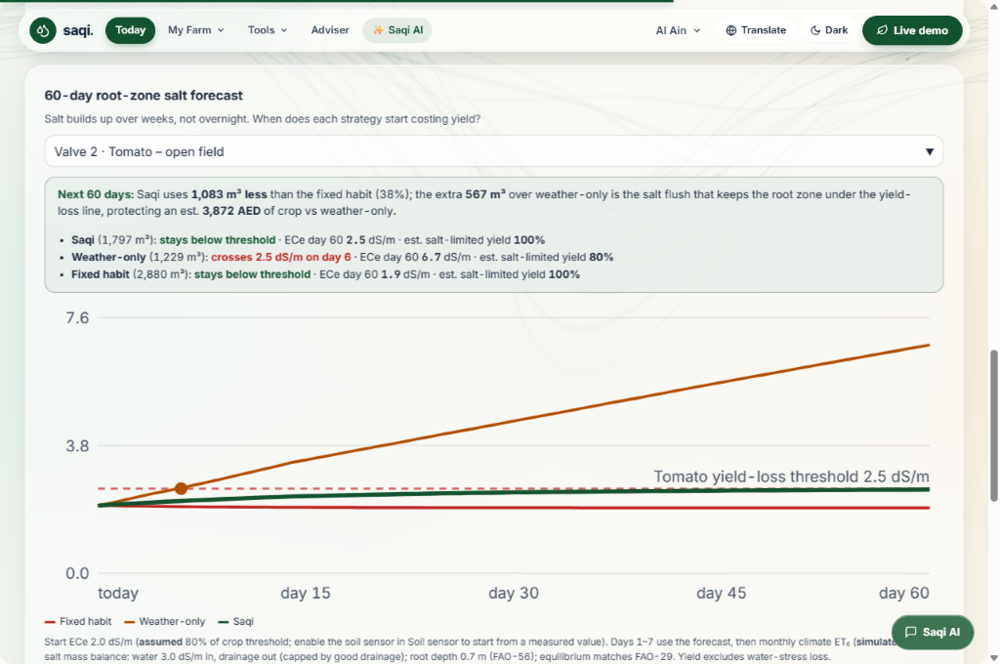
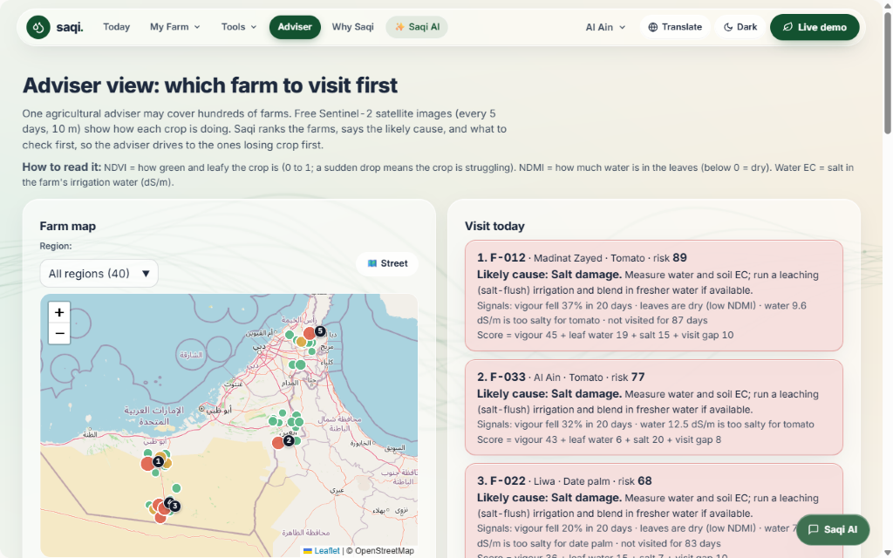
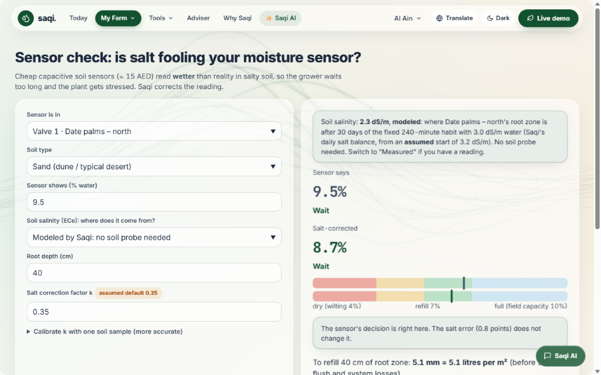

<div align="center">

# Saqi ساقي — Salt-Smart Irrigation for Desert Farms

**Turns desert weather, soil drainage, and brackish water salinity into exact nightly valve runtimes — plus multilingual voice, SMS, and offline QR instructions for field workers.**

[](https://saqi-gamma.vercel.app/)
[](https://saqi-gamma.vercel.app/#about)
[](https://saqi-gamma.vercel.app/#today)
[](#8-running-tests--verification)

[**Open Live App**](https://saqi-gamma.vercel.app/) · [**1-Minute Judge Walkthrough**](#2-1-minute-judge-walkthrough) · [**Core Equations**](#5-core-agronomic-equations-jsenginejs) · [**Quick Start**](#6-quick-start-local--vercel)

*Hackathon: Breaking Bytes Ch. 1 (GDG on Campus BITS Pilani Dubai) · Track: **Desert AgriTech** · Problem: **A-001 Smart Farming for the Desert***

</div>

---

## 1. The Problem Inside the Problem

Most irrigation dashboards only track evaporation. In Gulf & UAE desert farms, **two hidden realities** drive huge water waste and quiet yield loss:

1. **Salt flushing by guesswork:** Brackish groundwater leaves salt behind in the root zone. Fixed farm timers overwater heavily in cool weather and risk salt burn during heatwaves; pouring extra "flush water" by instinct either wastes scarce groundwater or waterlogs soils with poor drainage. Salt also fools cheap capacitive soil probes (~15 AED) into reading *wetter* than reality and slowly clogs drip emitters.
2. **Owner ≠ Worker:** Farm owners often manage remotely while field workers operate the valves and may speak Urdu, Hindi, Bengali, or Arabic rather than reading technical charts.

### How Saqi Beats Guesswork

| Strategy | Evaporation (ET₀ × Kc) | Minimum Salt Flush (FAO-29) | Drainage Cap & Heat Buffer | Outcome on Default Al Ain Farm |
|---|:---:|:---:|:---:|---|
| **Fixed Daily Timer (Habit)** | — | Guesswork | — | Wastes ~34–38% water on cool/moderate weeks; under-waters in extreme heat |
| **Weather-Only App** | Yes | Ignored (`LR = 0`) | Partial | Salt builds silently: Valve 2 (Tomato) crosses the `2.5 dS/m` yield threshold on **Day 6**, reaching `6.7 dS/m` (`80%` est. yield by Day 60) |
| **Saqi (`Engine` + Voice/QR)** | Live FAO-56 PM + Calibrated Offline Backup | Exact Rhoades Flush | `DRAINAGE` capped + `+10%` pre-heat buffer | Holds `2.5 dS/m` (`100%` est. yield), saves `1,083 m³` over 60 days on Tomato vs. habit, protects ~`3,872 AED` vs. weather-only, and briefs workers in **5 voice / 44 site languages** |

---

## 2. 1-Minute Judge Walkthrough

Open **[saqi-gamma.vercel.app](https://saqi-gamma.vercel.app/)** (no sign-up or hardware required):

| Step | Action in the App | What Judges Should Notice |
|---|---|---|
| **1. Hero & Live Preview** | Open `#home` and scroll through `#demo` | Same FAO-56 + FAO-29 engine powers the **Zone-A Simulator** (`Normal Day`, `48°C Heatwave`, `6.5 dS/m Salinity Spike`), clearly distinguishing `Scenario ET₀ (Hargreaves)` from live Open-Meteo ET₀ (`🔄 Seed from today's live ET₀`). |
| **2. Canonical Farm Plan** | Open **Tools → `⚖️ Judge Demo`** (or click **Today**) | Loads the Al Ain 4-valve farm (`Date palms`, `Tomato`, `Forage`, `Cucumber`) with big per-valve runtimes (`160 min after 21:00`), **`Likely range`** uncertainty brackets, and Valve 1's **`Why this runtime?`** math open. |
| **3. 60-Day Salt Forecast** | Scroll down on **Today** and pick **Valve 2 · Tomato** | Daily root-zone salt mass-balance curves showing exact day **Weather-only** crosses the `2.5 dS/m` yield-loss threshold (`Day 6`) vs. Saqi staying safe at equilibrium. |
| **4. 3-Tap EC Pen & Offline PDF** | Click **`⚡ EC Pen`** → tap `5.5 dS/m` · then click **`📄 1-Page Plan PDF (Offline)`** | Instant live recalculation across all valves, plus a zero-AI client-generated A4 printable brief with embedded scannable QR code. |
| **5. Owner → Worker Handoff** | Scroll to **Worker voice note, SMS & QR** (`#voiceBox`), pick **Urdu** + **📱 Worker QR Card** | Filter **All valves** or a single valve, play Web Speech audio aloud, preview WhatsApp/SMS, or print an offline UTF-8 QR slip. Toggle **`☀️ Field Mode`** or **`✈️ Airplane-mode test`** in Tools to test sunlit / zero-network operation. |
| **6. Regional Adviser Triage** | Click **Adviser** (`#adviser`) | Interactive **UAE Leaflet map** (`OpenStreetMap Street` ↔ `Esri Satellite` toggle) ranking 40 regional farms across Al Ain, Liwa, Al Dhaid, and Madinat Zayed with **Likely cause**, **What to check first**, and 4-signal score breakdown. |
| **7. Science Audit & Methodology** | Click **Why Saqi** (`#about`) | Scroll to **Live model checks (recomputed on your data)** (5 live checks + raw vs. calibrated Hargreaves ET₀ backtest) and the complete **Methodology** source table. |

---

## 3. Screenshots

<p align="center">
  
  <br>
  <sub><b>Today → 60-day root-zone salt forecast:</b> Weather-only crosses Tomato's <code>2.5 dS/m</code> yield-loss threshold on Day 6, while Saqi maintains target salinity with exact flushing.</sub>
</p>

<p align="center">
  
  <br>
  <sub><b>Adviser → Regional Farm Map &amp; Visit Triage:</b> Real UAE geography (OpenStreetMap Street + Esri Satellite toggle) with risk-ranked farms, likely causes, and arrival checklists.</sub>
</p>

<p align="center">
  
  <br>
  <sub><b>My Farm → Sensor Check:</b> Corrects capacitive moisture probe salt bias with or without a soil EC probe (using Saqi's daily modeled root-zone salinity by default).</sub>
</p>

---

## 4. Complete 11-Module Farm Toolkit

| View | Key Capability | Agronomic / Technical Method |
|---|---|---|
| **Home & Live Demo (`#home`)** | Desert problem framing + 4-slider Zone-A what-if simulator | `Engine.decideZoneA()` (90-day transient salt evaluation + scenario ET₀) |
| **Today (`#today`)** | Multi-valve schedule, likely runtime ranges, alerts, 7-day savings & 60-day salt chart, **Worker Voice / SMS / QR**, **`☀️ Field Mode`**, **`✈️ Airplane-mode test`**, **`📄 1-Page Plan PDF`** | FAO-56 Penman-Monteith ET₀ + FAO-29 Rhoades leaching + offline `jsPDF` + UTF-8 `qrcode.js` |
| **My Farm (`#farm`)** | Interactive **Leaflet GIS boundary & grid area calculator**, GPS with 15 s fallback timeout, **Open-Meteo + NASA POWER + Nominatim** live soil/solar feeds, direct `m³/h` or emitter × count flow | WGS84 geodesic `Engine.polygonStats()` + live land-surface telemetry |
| **Water Mix (`#blend`)** | Optimal RO desalinated vs. brackish well blending curve within well capacity & drainage bounds | Profit-maximising `Engine.optimiseBlend()` sweep across 0–100% blend |
| **Sensors (`#sensor`)** | Corrects capacitive probe salt bias (`"Wait"` → `"Irrigate now"`), works **with or without a soil EC probe** (modeled vs. measured toggle) + 1-sample oven-dry `k` calibration | Modeled transient root-zone `ECe` + `bias = k × ECe × reading / 10` |
| **Drip Health (`#drip`)** | Detects emitter clogging (`< 88%` flow for 2+ days) vs. lateral leaks (`> 112%`) from 14-day meter logs | `Engine.flowCheck()` ratio bands |
| **What to Plant (`#planner`)** | Ranks 9 desert crops by net AED return per ha and per `m³` under water salinity, well peak flow & drainage | `Engine.seasonPlan()` crop yield & drainage feasibility |
| **Date Harvest (`#harvest`)** | On-device date ripeness check (*Kimri, Khalal, Rutab, Tamr*), ignoring background green palm fronds | Central-frame Canvas HSV pixel classifier |
| **Water Sharing (`#share`)** | Cooperative *falaj* / shared-well trading credits & night-first pumping schedule (`18:00`) | `Engine.shareWater()` allocation & credit clearing |
| **Adviser (`#adviser`)** | Regional UAE Leaflet map (`Al Ain`, `Liwa`, `Al Dhaid`, `Madinat Zayed`) ranking 40 farms by risk, likely cause & arrival checklist | `45% NDVI + 25% NDMI + 20% salt + 10% visit gap` |
| **Saqi AI (`#assistant`)** | Grounded farm chatbot & multilingual RTL/LTR AI PDF report (44 site languages) | Google Gemini (`google-genai`) via `/api/ai/*` with server-side key & fabricated-number guard |
| **Why Saqi (`#about`)** | 1-minute pitch + **5 Live Model Checks** (self-verified against current inputs) + **Methodology table** | Live backtest of calibrated Hargreaves vs. Open-Meteo PM + mass-balance checks |

---

## 5. Core Agronomic Equations (`js/engine.js`)

| Concept | Formula / Method in Code | Reference |
|---|---|---|
| **Crop Water Use ($\text{ET}_c$)** | $\text{ET}_c = K_c(\text{stage, day}) \times \text{ET}_0$ | FAO Irrigation & Drainage Paper 56 |
| **Calibrated Offline $\text{ET}_0$** | $0.0023(T_{\text{mean}}+17.8)\sqrt{T_{\max}-T_{\min}}\,R_a\cdot 0.408 \times k_{\text{loc}}$ | FAO-56 Eq. 52 (Hargreaves), locally calibrated via `Engine.hargreavesBias()` |
| **Target Leaching Requirement** | $LR = \dfrac{EC_w}{5 \cdot EC_{e,\text{thr}} - EC_w}$, bounded by `DRAINAGE[drainage].maxLF` | Rhoades equation (FAO Paper 29) |
| **Transient Daily Salt Balance** | $W_e \,\Delta EC_e = I\,EC_w - D \cdot \dfrac{5\,EC_e}{1+LF}$, $\; W_e = 2\,\theta_{fc}\,z_{\text{root}}$ | `Engine.saltForecast()` — equilibrium matches FAO-29; root depth from FAO-56 Table 22 |
| **Gross Irrigation & Runtime** | $D_{\text{gross}} = \dfrac{\max(0, \text{ET}_c - R_{\text{eff}}) \cdot f_{\text{heat}}}{(1 - LR)\cdot E_a}$, $\; t = \dfrac{D_{\text{gross}} \cdot A \cdot 10}{Q_{\text{block}}} \times 60$ | Single non-overlapping application of $LR$ and $E_a$ (`blockDecision()`) |
| **Estimated Relative Yield** | $Y = \max\big(0, 1 - \frac{b}{100}(EC_e - EC_{e,\text{thr}})\big) \times \big(1 - K_y(1 - \frac{I}{\text{ET}_c})\big) \times f_{\text{wl}}$ | Maas–Hoffman & FAO Paper 33 |
| **Runtime Uncertainty Bracket** | Re-evaluated at $\text{ET}_0(1 \pm u)$, $EC_w \pm (2\% + 0.1)$, $E_a \pm 0.05$ ($u = 10\%$ live, $15\%$ cached, $20\%$ climate) | `Engine.runtimeRange()`, `UNCERTAINTY` (`js/data.js`) |

<details>
<summary><b>Data Provenance &amp; Honesty Disclosure (Real APIs vs. Synthetic Demo vs. Assumptions)</b></summary>

| Dataset | Status | Source / Handling |
|---|---|---|
| 7-day forecast, Penman-Monteith $\text{ET}_0$, VPD, soil moisture & temps | **Real live API** | Open-Meteo Forecast & ECMWF/ICON land-surface model |
| Monthly solar irradiance & temperature normals | **Real live API** | NASA POWER Agroclimatology Satellite (`power.larc.nasa.gov`) |
| Reverse geocoding & place search | **Real live API** | OpenStreetMap Nominatim |
| Street & satellite map tiles | **Real live tiles** | OpenStreetMap & Esri World Imagery via Leaflet |
| Crop $K_c$, $EC_e$ thresholds, Maas–Hoffman slopes, root depths | **Real published** | FAO Papers 29, 33, 56 |
| Date harvest pixel ripeness classification | **Real on-device** | HTML5 Canvas RGB → HSV classifier |
| 14-day flow meter logs, scenario weeks & 40 Adviser farms | **Synthetic demo** | Clearly labelled realistic seeded datasets in app |
| UAE crop prices, yields & capacitive sensor $k = 0.35$ | **Illustrative / Assumed** | Editable defaults + 1-sample calibration wizard |
| Start $EC_e$ (without sensor) & input error margins (`UNCERTAINTY`) | **Assumed & labelled** | Shown inside the 60-day chart caption and runtime range notes |

</details>

---

## 6. Quick Start (Local & Vercel)

### Run Locally in 10 Seconds
- **Windows:** double-click or run `.\start-saqi.bat`
- **macOS / Linux:** `chmod +x start-saqi.sh && ./start-saqi.sh`
- **Manual Python 3.10+:**
  ```bash
  git clone https://github.com/Rifvik/saqi.git
  cd saqi
  pip install -r requirements.txt
  cp .env.example .env   # add GEMINI_API_KEY inside .env (git-ignored)
  python server.py       # on Windows, use `py -3 server.py` if needed
  ```
  Open **`http://127.0.0.1:8765/index.html`** *(for offline AI UI testing without a key, set `SAQI_AI_MOCK=1`; for static calculators only with no Python server, `npx --yes serve -l 8765 .` works too)*.

### Deploy on Vercel (Static CDN + Python Serverless `/api/ai/*`)
1. Import **`Rifvik/saqi`** in Vercel (uses `vercel.json` with `"framework": null`, builds static frontend into `dist/` via `build_dist.mjs`, and deploys Python 3.12 functions `api/ai/{status,chat,report}.py`).
2. Add Environment Variables under **Project Settings → Environment Variables**:
   - `GEMINI_API_KEY` *(required for live AI chat & farm reports — never shipped to the browser)*
   - `GEMINI_MODEL` *(optional — defaults to `gemini-3.8-flash` with Flash fallbacks)*
   - `SAQI_AI_MOCK=1` *(optional — enables deterministic demo AI replies without a Gemini key)*
3. Deploy — all agronomic tools work even with zero env vars, and `/api/ai/status` exposes live AI readiness.

<details>
<summary><b>7. Repository Architecture (Vanilla Stack + Zero-CDN Offline Vendor Assets)</b></summary>

| Path | Role |
|---|---|
| `index.html`, `styles.css` | Single-page responsive app shell + Light Oasis / Dark Obsidian frosted-glass CSS variables & Sunlit Field Mode (`[data-field-mode="1"]`) |
| `js/data.js`, `js/engine.js` | Zero-DOM FAO-56/29/33 agronomic tables, transient 60-day salt balance, runtime uncertainty & 5-language worker phrase bank (`ur`, `hi`, `bn`, `ar`, `en`) |
| `js/tools.js`, `js/app.js`, `js/ai.js`, `js/shader-bg.js`, `js/hero-cinema.js` | Interactive calculators, Leaflet GIS + UAE Adviser maps, offline 1-page PDF/QR handoff, 44-language site translator, WebGL shader & GSAP hero |
| `vendor/` | Local vendored copies of `gsap.min.js`, `ScrollTrigger.min.js`, `html2canvas-pro.min.js`, `jspdf.umd.min.js`, and UTF-8 `qrcode.js` |
| `sw.js`, `manifest.json`, `icon.svg` | PWA offline Service Worker (`saqi-v29`, network-first `no-cache` revalidation + offline cache fallback, bypassing `/api/`) |
| `ai_service.py`, `ai_http.py`, `ai_mock.py`, `server.py`, `api/ai/*.py` | Shared Gemini AI backend (rate limit, 256 KB guard, secret masking, number-grounding verifier) serving both local `server.py` and Vercel serverless handlers |
| `vercel.json`, `build_dist.mjs`, `.python-version`, `.vercelignore` | Clean separation staging only public frontend assets into `dist/` so `.py` backend files, `.env*`, and `tests/` return `404` publicly |

</details>

---

## 8. Running Tests & Verification

```bash
node --check build_dist.mjs js/data.js js/engine.js js/tools.js js/app.js js/ai.js js/hero-cinema.js js/shader-bg.js sw.js
node --test tests/engine.test.js      # 14/14 pure agronomic engine, transient salt, range, QR & GIS checks
python -m unittest discover -s tests -v  # 9/9 AI service, mock, local HTTP server & Vercel handler checks
```

> **Scope & Disclaimer:** After first visit, `sw.js` caches core assets locally and `localStorage` retains forecasts with calibrated Hargreaves $\text{ET}_0$ offline fallback. Map tiles (OSM/Esri), Google Translate, and live satellite/public feeds require connectivity when fetched; SMS/WhatsApp buttons open device composers as previews. All modeled root-zone salinity ($EC_e$) values and relative yield figures are decision-support estimates rather than guaranteed field measurements.
